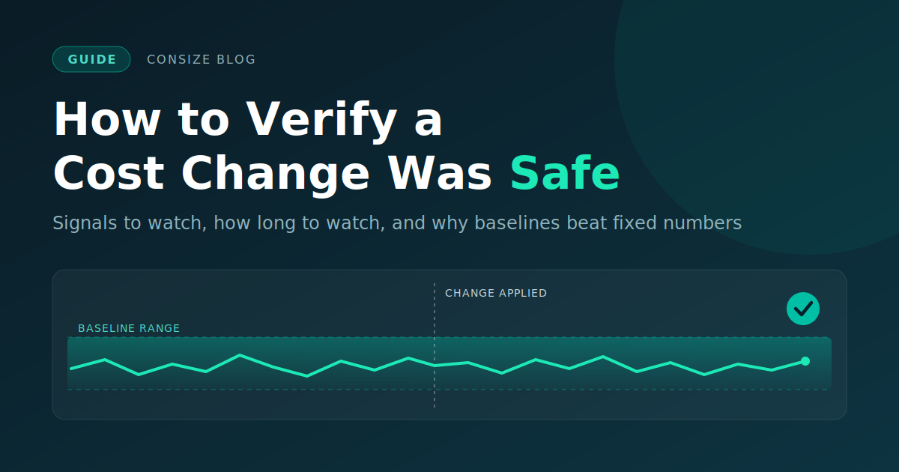

# How to Verify a Cost Change Was Safe



Before you cut anything, decide what failure would look like:

<!-- more -->

- Which numbers,
- Compared to what and
- For how long. 
It's much easier to decide that before you've
seen the results than after.

This post covers what to watch, how long to watch it, and why to compare against
a baseline instead of a fixed number. It has a great
checklist at the end.

<!-- more -->

## Decide what "safe" means first

Before you apply anything, write down what you'll treat as a failure. Once you've
seen the data, it's easy to decide a slightly worse result is fine.

For most changes, safe means four things: 

- Errors and latency didn't get worse
- The system still handles its normal peaks
- The services that depend on it are
unaffected
- The cost actually went down.

## Signals to watch

Start with the four golden signals from the Google SRE book's chapter on
[monitoring distributed systems](https://sre.google/sre-book/monitoring-distributed-systems/):
(latency, traffic, errors, and saturation). 
Look at percentiles such as p95 and p99
rather than averages, since an average can hide a slow tail.

Then add signals for the thing you changed:

| Change | Watch first | Easy to miss |
|---|---|---|
| CPU or instance downsize | CPU saturation or throttling, p99 latency, queue depth | Latency at peak, batch jobs running past their window |
| Memory reduction | Out-of-memory kills, restarts, GC pauses, swap | Slow leaks that only reach the new limit after hours |
| Database instance downsize | CPU, IOPS, free memory, connection count, replication lag, slow queries | Running out of connections at peak, cold caches after the resize |
| Fewer replicas or nodes | Error rate, load on the remaining capacity | Whether you can still lose one node and stay up |
| Cheaper storage tier | Read latency, retrieval errors, request charges | Occasional reads from a cold tier being slow or costly |
| Spot or preemptible capacity | Interruption rate, rescheduling time, job completion rate | Interruptions landing at a bad time |
| Smaller or cheaper AI model | Quality or task-success score, retry and fallback rate, latency, cost per task | Quality dropping on edge cases that averages hide |

Also watch the services that call the one you changed, since they often show
problems first. Pair at least one signal that fails fast (errors, crashes) with
one that fails slowly (memory growth, queue depth), and track the saving itself,
not only the health of the system.

## How long to watch

Three things decide this. One is how long the change takes to settle: rollouts
finish and caches warm up. Another is how your load varies, because a change
checked at 3am says little about Monday morning. The third is risk: a bigger
step, a more critical service, or a change that's hard to undo all justify
watching longer.

Note: these windows are starting points, not
standards:

| Phase | Window | Looking for |
|---|---|---|
| Immediate | First 5 to 15 minutes | Crash loops, error spikes, failing health checks |
| Short | First 1 to 4 hours | Saturation under normal load, latency drift, early memory growth |
| Full cycle | 24 hours to a week | Peak-hour behavior, daily and weekly jobs, slow leaks |

If you make a large reduction in several steps, watch the later steps longer,
because each one leaves less headroom.

For noisy signals like latency and error rate, require the regression to last a
few minutes before you act on it. Act immediately on hard failures such as crash
loops, out-of-memory kills, and failing health checks.

If the data is missing, you don't have a pass. Extend the window or fix the gap.

## Compare to a baseline, not a fixed number

A fixed threshold, like "p99 under 500 ms," is easy to set up, but it has
problems:

- **It can't fit every service:** 500 ms might be fine for a reporting API and too
  slow for checkout.
- **It misses relative regressions:** A service at 40 ms p99 that goes to 160 ms is
  four times slower and still passes.
- **It ignores load patterns:** Monday morning and Sunday night behave differently,
  so a result may reflect traffic rather than your change.
- **It answers the wrong question:** You want to know whether this change made
  things worse, not whether the system is generally healthy.

Keep a fixed ceiling as well, for limits you never want to cross, such as an SLO.
The baseline catches relative regressions and the ceiling catches absolute ones.

To build the baseline:

- Use a window before the change that's as long as the window after it.
- Match time of day and day of week, for example the same hours last week.
- If you can, compare changed instances to similar untouched ones at the same
  time. That helps separate your change from traffic shifts and outside events.
- If load differs, compare per-request or per-unit numbers.
- Leave out incidents, deploys, and load tests.
- Pair a relative threshold with an absolute floor. A rise from 0.01% to 0.02%
  errors is a 100% increase, but it probably doesn't matter.

As an example only, a rule might fail the change if p99 stays more than 30% above
baseline for five minutes. Pick your own numbers from your SLOs.

A few things might spoil the comparison: a baseline taken from an already degraded
period, a baseline that's too short, a post-change window that overlaps the
rollout, and a second change made at the same time, which makes it hard to tell
which one caused a problem.

## Reaching a verdict

Give each change one of three outcomes:

- **Pass:** signals stayed within the baseline range and no ceiling was crossed.
  Mark it verified and record the savings.
- **Fail:** a signal regressed past your threshold. Roll back, keep the evidence,
  and find the cause before trying again.
- **Inconclusive:** data is missing or the result is unclear. Extend the window or
  fix the gap. Don't call it safe by default.

Rollback needs preparation. Record the exact previous values, find out how long
a rollback takes (resizing a database may not be quick to undo), and automate it
for fast-moving signals where you can.

## Check the savings too

Compare projected savings to realized savings. Billing data lags, so use a usage
estimate first and check it against the bill later. Also look for savings that
move somewhere else: a downsized service that causes more retries, or extra
capacity added elsewhere, can offset the saving.

## Checklist

??? tip "Cost change checklist"

    **Before the change**

    - [ ] The change is a single change, with no other deploys or config changes at the same time
    - [ ] Pass and fail criteria are written down
    - [ ] Signals chosen, including one fast-failing, one slow-failing, and one for cost
    - [ ] Dependent services are on the watch list
    - [ ] Baseline window defined, free of incidents, matched for time of day and week
    - [ ] Previous state recorded exactly, and rollback tried or rehearsed
    - [ ] Watch windows set, including at least one representative peak
    - [ ] Owner and alert route confirmed

    **During the watch**

    - [ ] Waited for the change to settle before starting the comparison window
    - [ ] Checked the first 15 minutes for crashes, errors, and health checks
    - [ ] Checked the first few hours for saturation, latency drift, and memory growth
    - [ ] Compared against the baseline using percentiles, adjusted for load
    - [ ] Checked hard ceilings alongside relative thresholds

    **After**

    - [ ] Verdict recorded (pass, fail, or inconclusive) with evidence
    - [ ] If it failed: rolled back, and the cause understood before retrying
    - [ ] If inconclusive: window extended or data gaps fixed
    - [ ] Realized savings checked against the bill
    - [ ] Next step's size and watch window adjusted

## Template

??? tip "One-page verification plan"

    ```
    Change:            what, where, by how much (e.g. db-main: large -> medium)
    Owner / on-call:   who is watching and who can roll back
    Expected savings:  $X/month projected; check against billing by <date>
    Rollback plan:     exact previous state: <values>; time to roll back: <duration>

    Signals:           fast-failing: error rate, p99 latency
                       slow-failing: connection count, memory growth, queue depth
                       quality/business: <metric>
    Dependents:        <services that call this one>

    Baseline:          same hours last week, plus untouched peers; excludes <incidents>
    Thresholds:        p99 +30% and at least 20 ms for 5 min -> fail
                       hard ceilings: error rate above <SLO>, any crash loop -> fail now

    Watch windows:     0-15 min, 1-4 h, through the next peak
    Verdict rules:     pass / fail / inconclusive (missing data = inconclusive)
    ```

We're building Consize around this loop: small steps, verification against a
baseline, and automatic rollback. If you want to see it work without touching
production, the sandbox runs locally with Docker.

[Try the Interactive Sandbox](../../getting-started/sandbox.md){ .md-button .md-button--primary }